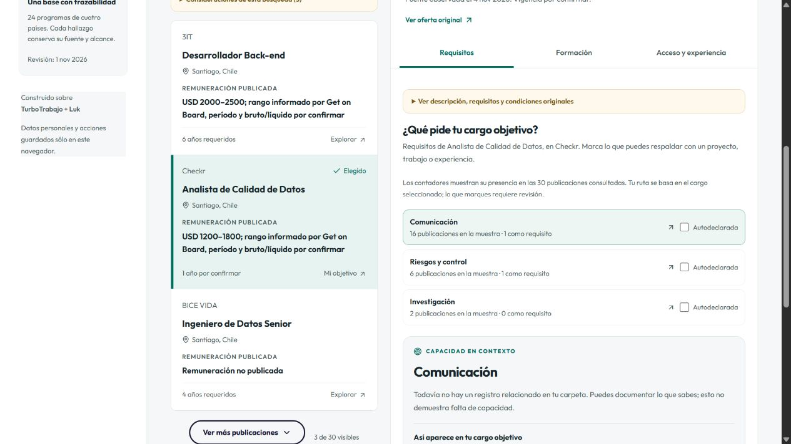

# Mejoras de captura y dashboard — 4 de noviembre de 2026

Esta entrega aplica las correcciones de la revisión del enjambre. La referencia anterior es la versión `605bd8475083663e80a56b65e4008a5253bdcb2e`. Se conservan la atribución de TurboTrabajo y Luk, los datos documentados y el funcionamiento local del piloto.

## Antes y después

| Área | Antes | Ahora |
|---|---|---|
| Captura | URLs con seguimiento podían duplicar registros y conteos. | La identidad se normaliza y se deduplica antes de contar. |
| Cobertura | Treinta resultados podían parecer toda la búsqueda. | La respuesta y el dashboard muestran página, total de páginas cuando se conoce y alcance del filtro de ubicación. |
| Errores | La espera indicada podía contradecir al proveedor; un timeout del cuerpo era genérico. | La espera efectiva se conserva; la interfaz muestra una cuenta regresiva sin consultas automáticas. Los rechazos de acceso detienen esa fuente y los timeouts se clasifican. |
| Interpretación | Una negación podía convertirse en requisito; `1.5` podía leerse como cinco años. | Se conservan decimales, contexto de listas, negaciones y requisitos obligatorios frente a deseables. |
| Experiencia | Distintos mínimos se reducían al primero encontrado. | Se conservan los mínimos por función y su evidencia; los años totales no demuestran experiencia específica. |
| Oportunidades | Compartir sólo comunicación o área podía generar una sugerencia. | La relación exige una capacidad específica compartida y no premia publicaciones por tener menos información. Sigue siendo una regla inicial, no una evaluación humana. |
| Dashboard | Introducción alta, tarjetas dispersas y grandes superficies lavanda. | Búsqueda compacta, lista junto al detalle, superficies neutras, acento petróleo y pestañas de requisitos, formación y acceso. |
| Objetivo | Una vista previa podía sustituir el cargo de la ruta y distintas secciones podían mostrar objetivos diferentes. | La elección se guarda en un único estado persistido; las vistas previas y las importaciones no la sustituyen. Elegir una práctica lo indica expresamente. |
| Evidencias | Una casilla y un registro documental compartían significado. | Las autodeclaraciones y los registros de la carpeta se cuentan por separado; ninguno acredita dominio automáticamente. |
| Navegación | Elegir un cargo en móvil obligaba a buscar su detalle; cambiar vista podía perder el foco. | Hay salto al detalle, regreso al cargo y foco en el encabezado de la vista de destino. |
| Recuperación | Al reimportar una oportunidad podía perderse el texto del horario. | Se preservan horario, descripción y horas explícitas sin duplicar el texto ni interpretar un tipo de empleo como jornada. |

## Comprobaciones

La revisión en navegador obtuvo treinta publicaciones reales y la API declaró dos páginas; sólo se consultó la primera. Eso prueba funcionamiento puntual, no cobertura exhaustiva ni vigencia futura de cada vacante. Se comprobó navegación por pestañas con teclado, selección y regreso en móvil de 320 px, y separación entre una autodeclaración de SQL y un registro temporal de evidencia. El registro temporal se retiró después de la prueba.

El analizador en pantalla mantuvo SQL como obligatorio, no convirtió «No es obligatorio Python» en exigencia y conservó 1,5 años de experiencia. Las pruebas automáticas incluyen además cambios de orden entre requisitos/preferencias, experiencia por ámbito, duplicados, cobertura, pausas, timeouts y reimportación.

La validación final aprobó **138 pruebas en 11 archivos**, TypeScript y la compilación de producción. ESLint sobre los archivos de producción modificados terminó sin errores y con una advertencia previa por un import sin uso. `git diff --check` no encontró errores de espacios.

En la versión compilada se eligió un cargo, se ejecutó otra búsqueda y se comprobó que «Mi ruta» conservara la elección anterior después de recargar y exportar. La recuperación mantuvo el horario. También se verificó el foco del encabezado al cambiar de sección, la ausencia de desbordamiento horizontal a 390 y 1366 px y la consola sin errores ni advertencias. Las comprobaciones previas a 320 px cubrieron las cuatro vistas. No se realizó una certificación de accesibilidad ni un estudio con usuarios.

La revisión final detectó y corrigió otra discrepancia entre secciones. Se comprobó el recorrido cargo → elegir práctica → volver al buscador: el cargo anterior quedó como vista previa. Elegir ese cargo desde «Oportunidades» actualizó el rótulo del buscador; la elección se mantuvo después de recargar. TypeScript y la compilación se repitieron tras este ajuste y aprobaron.

## Propuestas para la siguiente iteración

1. **Relevancia medida:** construir la batería anotada de consultas, requisitos y pares cargo–práctica antes de añadir un orden personalizado o interpretación con IA. Medir errores y pertinencia, no inventar un porcentaje de empleabilidad.
2. **Ruta de aprendizaje:** usar nivel y prerrequisitos documentados para separar formación de entrada, preparación pendiente y pasos posteriores. El catálogo actual conserva esos requisitos visibles, pero todavía no evalúa admisión.
3. **Dashboard universitario:** tabla requisito → asignatura → profundidad documentada → evaluación → responsable → próxima acción. Conservar versión y cohorte, distinguiendo malla de programa detallado.
4. **Panel de fuentes:** seguimiento de fecha, cobertura, duplicados y revisión pendiente, separado del recorrido del estudiante; ampliar fuentes por carrera y tipo de empresa.
5. **SaaS compartido:** persistencia por organización, roles y coordinación de cuotas/pausas entre procesos. El piloto actual sigue guardando el perfil en este navegador y consultando una página por búsqueda.

## Evidencia visual

Capturas reales del navegador: [antes](capturas/antes-mejoras-2026-11-04.png), [después en escritorio](capturas/despues-mejoras-2026-11-04.png) y [después en móvil](capturas/despues-movil-2026-11-04.png).

