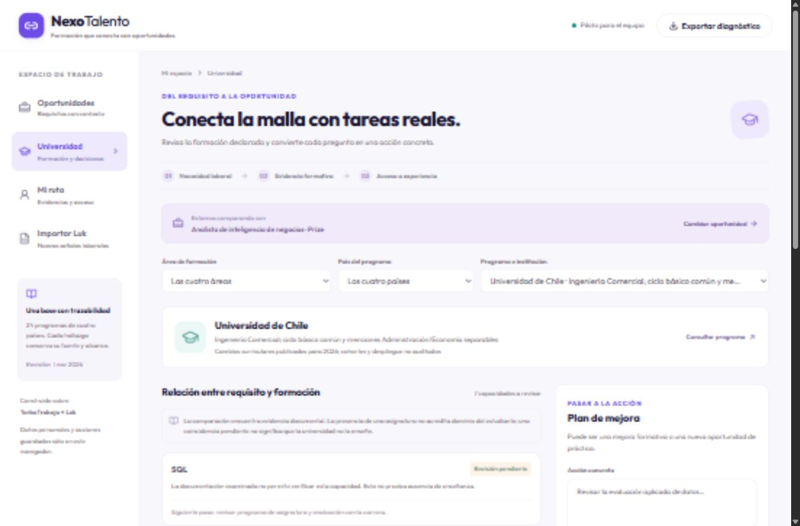

# Verificación de la entrega

Revisión local del 3 de noviembre de 2026, zona horaria de Chile continental. Equipo Windows, Node.js y Python en entorno separado. Los registros pueden tener fecha UTC del 4 de noviembre.

## Resultados comprobados

| Comprobación | Resultado |
|---|---|
| Manifiesto, lock y `npm ls --depth=0` | Correctos |
| TypeScript | Sin errores |
| Pruebas de la plataforma | 79 aprobadas en 7 archivos |
| Pruebas del scraper Luk incorporado | 439 aprobadas |
| Build de producción Next.js | Correcto, 24 rutas estáticas generadas |
| Servidor local y `/nexo` | HTTP 200, sin credenciales externas |
| Captura pública acotada | 15 ofertas de una página; detalle de 2, 4 solicitudes, 0 errores |
| Adaptador de esa captura | 15 registros, 0 errores de fila |
| Importación de la captura en navegador | 15 registros incorporados |
| Importación de ejemplos | 2 registros identificados como ficticios |
| Comparación curricular | Muestra fuentes, contenidos declarados y revisión pendiente; cambio de país/programa funcional |
| Plan de mejora | Acción, responsable, fecha y cambio de estado guardados localmente |
| Perfil y evidencia | Guardado autodeclarado y persistencia tras recargar comprobados |
| Barrera horaria | Una oferta de 40 horas bloquea disponibilidad de 20; pasa a coincidencia horaria al declarar 40 |
| Consola del navegador durante el recorrido inicial | Sin errores registrados |
| Exportación descargada y leída | 17 importaciones únicas, 1 evidencia, 1 acción en curso y perfil de 40 horas preservados |
| Regresión de tracking entre lotes | Dos URLs adicionales con `utm_source` distinto no duplican el registro ni la exportación |
| País compuesto | Fintual Chile / México aparece al filtrar México; contador de 5 países sin sumar desconocidos |
| Diseño adaptable | Las cuatro vistas sin desbordamiento horizontal a 320, 390 y 1366 píxeles |
| Compilación posterior a correcciones | Correcta; TypeScript y generación de páginas aprobados |
| Consola al terminar el recorrido | Sin errores registrados |

La captura real se mantiene en `.local-data/`, fuera de Git. La muestra incorporada al código contiene 24 programas, 156 evidencias curriculares y 22 registros laborales/vías únicos. De estos últimos, 13 tienen vigencia sin confirmar, 6 son vías institucionales y 3 son referencias históricas. No se convierten en vacantes abiertas por importarlos.

## Correcciones surgidas de la revisión

- Deduplicación entre lotes por identificador y URL canónica, ignorando parámetros de seguimiento; también se aplica a la exportación.
- Las ofertas para Chile / México aparecen en ambos filtros; los valores compuestos y los países por confirmar no inflan el contador.
- La indicación explícita de ausencia de experiencia previa requerida se presenta con ese significado.

## Dependencias y límites de entrega

Se actualizaron dependencias compatibles, incluyendo Next.js 16.4.5 y Zod 4.6.7. La auditoría npm bajó de 54 avisos (2 críticos) a 25 (0 críticos, 5 altos, 18 moderados y 2 bajos). En el árbol de producción quedan 11 avisos, incluidos los 5 altos en Nodemailer y la cadena Firebase/Firestore/grpc. Resolverlos requiere actualizaciones mayores o sustituciones con pruebas de los servicios originales.

La demo `/nexo` funciona localmente sin Firebase, correo ni pagos; conservar el código original no equivale a habilitar esos servicios para producción. No se configuró ni publicó un servicio multiusuario. La persistencia es de este navegador, las habilidades son autodeclaradas y la extracción usa reglas revisables. Las pruebas de scraper validan su implementación y la captura limitada confirma acceso puntual, no disponibilidad futura del portal.

La configuración de GitHub Actions está incluida. Su estado remoto debe comprobarse en GitHub; los resultados de esta tabla son locales.

## Evidencia visual

