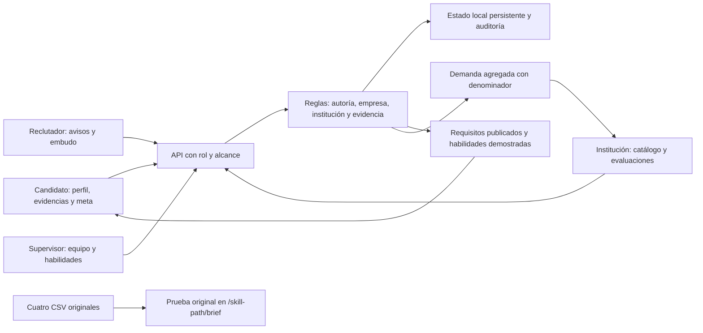

# Arquitectura de la ampliación de Skill path

El contrato común está en `src/lib/skill-path-product/types.ts`. Las vistas consumen respuestas filtradas por el servidor. El selector de identidad es únicamente una facilidad de demostración, no una barrera de autenticación para producción.

## Límites de cada cuenta

| Rol | Lectura | Escritura |
| --- | --- | --- |
| Candidato | Perfil y evidencias propios; avisos y catálogo publicados; sus postulaciones y solicitudes | Su perfil, su meta, evidencias, postulaciones y solicitudes de formación |
| Reclutador | Procesos asignados; experiencia dirigida a su empresa | Avisos de su empresa, etapas de procesos asignados, acreditación pertinente |
| Supervisor | Procesos y reclutadores de su empresa | Gestión de su empresa, asignación de avisos, habilidades base/recomendadas |
| Institución | Oferta y participantes propios; demanda agregada | Su catálogo y evaluaciones de sus participantes |

Las habilidades verificadas proceden de una revisión autorizada y conservan el vínculo con su evidencia. Los proyectos adjuntos pendientes y las declaraciones no se convierten en acreditaciones automáticamente. Una evaluación de actividad guarda las habilidades demostradas y el actor responsable; asistir o inscribirse no basta.

## Almacenamiento y cambios

El estado nuevo vive fuera de los CSV originales, bajo `.local/skill-path-product/`, excluido de Git. Las mutaciones usan versión esperada y clave de idempotencia, escritura serializada para una sola instancia y auditoría con actor y fecha. Los documentos no se sirven desde `public/`; su descarga comprueba el mismo alcance que la evidencia.

No hay motor predictivo ni decisión de contratación automática. El cruce de habilidades es explicable por requisito publicado. La demanda se cuenta por aviso, evitando contar dos veces la misma habilidad repetida; no representa todo el mercado laboral.

## Herramientas y verificación

Codex coordinó agentes de backend, frontend y revisión. Next.js, React, TypeScript y Zod constituyen el MVP; Vitest verifica reglas y negativas de acceso. El navegador permite observar los recorridos reales. Los resultados y límites efectivos se registran en `VERIFICACION.md`, sin inferir una certificación de producción a partir de una compilación.
