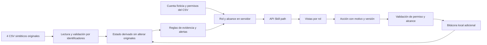

# Arquitectura de Skill path

Skill path implementa la Prueba 2 de mercado laboral: reconstruir postulaciones, explicar evidencia y registrar intervenciones autorizadas. La organización ficticia del caso es Nexo Laboral Group; Skill path es el nombre del producto del equipo.

## Datos y almacenamiento

Los archivos se copian sin modificaciones a `data/skill-path/source/`. Los hashes SHA-256 están en `FUENTES.json`. Se relacionan por `vacante_id`, `postulacion_id`, `candidato_id` y los identificadores de actores. Los nombres ficticios sólo sirven al selector de cuentas.

Las operaciones nuevas se conservan en `.local/skill-path/ledger.json`, fuera de Git. La lectura combina la fuente original y esa bitácora. La escritura atómica y la versión evitan perder modificaciones en la instancia local; una clave de idempotencia identifica el reintento de una misma intención. El archivo no sustituye una base transaccional con varias instancias. Los originales nunca se corrigen para disimular anomalías.

## Permisos y vistas

El navegador recibe proyecciones del servidor según cuenta. No recibe todos los CSV para filtrarlos localmente. El selector está permitido por el brief y no representa autenticación productiva. Las mismas reglas se aplican al consultar y al ejecutar una acción.

| Rol | Alcance y límite |
|---|---|
| Candidato | Sus postulaciones por actor_id. Estado, fecha, fuente y siguiente paso; solicitud de corrección propia. Sin eventos internos. |
| Reclutador | Vacante asignada a su actor **y** empresa incluida en su cartera. Cambios de etapa y correcciones documentadas según permiso. |
| Representante | Empresa propia; métricas propias y solicitudes de pausa/cierre. No ejecuta directamente acciones que la matriz deniega. |
| Administrador | Integridad técnica, alertas, métricas y automatizaciones permitidas. No decide selección. |
| Orientador | Candidatos del rango de su cartera. Orientación y alertas; no cambia decisiones. |
| Revisor | Casos marcados y que satisfacen el criterio de su subcartera. Documenta revisión; no modifica etapas con permiso No. |

El candidato necesita fecha y fuente según el brief y su tarjeta, aunque el diccionario clasifica algunos campos como internos. Se ofrece esa proyección mínima de su propio estado, sin actores internos ni bitácora completa. Se documenta esta interpretación para revisión del equipo evaluador.

## Reglas que preservan incertidumbre

Un campo vacío permanece desconocido. Los hechos respaldados, inferencias, antigüedad y ausencia de información tienen etiquetas separadas. La fecha operacional es el día de Chile mostrado por la API; las pruebas fijan un día para obtener resultados reproducibles. Más de 30 días sin actualización ni evento reciente producen alerta. La fecha de cierre vencida no cambia automáticamente Activa a Cerrada.

Una discrepancia de estado o un quiebre de trazabilidad requiere revisión. Un recordatorio registra una actividad local sin afirmar entrega al candidato. Una decisión adversa no puede surgir de automatización; una transición humana exige autorización y motivo. El motivo no autoriza criterios externos o sensibles.

Los recordatorios y solicitudes administrativos no reinician el reloj de avance del proceso: registrar un aviso no equivale a que se haya revisado una postulación. Esta decisión evita aparentar actividad; se explicita en la métrica de antigüedad y se prueba por separado.

## Límites del caso

No hay fuentes externas, scraping, correo real, autenticación productiva, ranking ni predicción de contratación en el módulo. El antiguo `/nexo` y TurboTrabajo conservan su código y atribución en rutas separadas; no forman parte de la demo evaluada ni aportan datos a Skill path. El historial de ese piloto se explica en `LEGADO_NEXO.md`.

## Herramientas utilizadas

- Codex y agentes especializados para leer especificaciones, implementar backend/vistas y revisar requisitos.
- Next.js, React y TypeScript de la base del equipo.
- Vitest para reglas, permisos y API; compilación y análisis estático locales.
- Python y lectores OOXML/PDF para extraer los documentos entregados sin reescribir sus fuentes.
- Navegador controlado para comprobar interacciones y vistas. Las comprobaciones realizadas se registran en `VERIFICACION.md`.

La aplicación no llama a un modelo de IA para decidir sobre candidatos. Las herramientas asistieron al equipo de desarrollo; las reglas del producto son explícitas y revisables.
